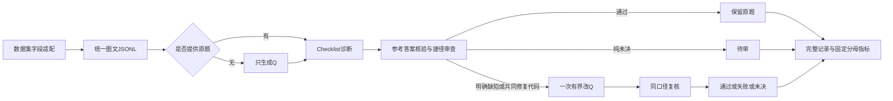

# 实施方案与当前分析计划

当前评估器的工程入口是 `necessity-ensemble-init/run/report`（见 README“信息必要性评估入口”）；其定义见数学参考第9节。下文按时间记录的评估探针（2026-11-12）为历史步骤。

更新日期：2026-11-13。研究定义见 [VQG_Proposal.md](../VQG_Proposal.md)。本文给出实施顺序，不表示所列目录、命令或模块已经实现。

## 当前研究主线与执行顺序

当前目标是描述baseline在真实test材料上生成的Q，有多少既有材料支持又必须结合图文回答。可回答性/忠实性和双模态必要性分开判，实际解题器对错、拒答与BDR单独报告。当前工作是分析阶段；所提生成方法的正式比较尚未完成。

| 内容 | 已有证据 | 当前边界 |
|---|---|---|
| 数据 | 官方ScienceQA test含hint+image材料1257组，47组有多附图；来源、图文哈希已保存 | 不按联合空间或输出质量筛选；这只是该材料子集，不是全部ScienceQA test题 |
| 评估定义 | 固定Q/K，分别检查保留材料的充分解法或缺失材料变化见证；理论、核验代码和隔离记录齐全 | 模型核验会误放行，未决方向不能翻成相反标签 |
| 评估器诊断 | 27份证明/65调用的封存诊断已完成；未达到采用分离检查的条件 | 不修改默认核验器；控制集表现不等于自然题准确率 |
| Qwen baseline30 | Qwen3-VL-8B自然生成与四条件答题已完成；本轮追加30次API评估 | 最新23可回答/5明确失败/2条件争议；可答题中1双必要/19非双必要/3必要性待裁定。审核非盲AI |
| API baseline1257 | 按用户新指令改为16路异步，仅生成Q与TI回答；全1257已处理，生成1256题、1237作答、18拒答、1生成失败、1回答失败 | 跑完后才启动独立评估；旧穿插四条件/评估的运行已停，结果保留；不与Qwen合并 |
| 所提生成方法 | 既有普通/强提示、锚定及checklist原型与历史开发结果保留 | 本轮不跑方法排名、训练或更大的新批次；baseline分析不能证明方法优于它 |

先完成以下分析，再进入方法设计或正式对比：

1. **已有30题的证据复评。** 本轮已完成31个封存调用名额中的30次HTTP（1次因无完整证明跳过），64,480 tokens。补出Q05双必要证据，以及Q13/Q14文本充分解法；Q07/Q16/Q26继续保留具体方向未决。Q02/Q22的热平衡/速率分布默认条件存在解释分歧，具名复核改为可答性待裁定，不靠模型投票强判通过。
2. **全量API baseline分两步执行。** 用户最新要求简单baseline、图片限大小、异步并发16线程、跑完再评估，优先于此前逐题穿插评估的安排。旧`luna-api-baseline-test1257-v1`已停止；新`luna-api-baseline-test1257-simple-v1`每题仅plain-v1生成→独立完整图文TI回答，两步有真实依赖，不同题16路异步。长边≤1024、像素≤100万、文件≤512KiB；当前原图全部小于上限，保持原图避免损伤读数。全1257处理已完成，新HTTP2186、884,653 tokens、复用149次完全匹配旧调用。失败和拒答保留，不按质量重采样。生成阶段没有四条件、参考构建、评分或必要性调用。

   全批完成后启动`luna-api-baseline-test1257-eval-v1`独立评估，16路并发；init强制检查所有原始名额均已处理，之后再评可答性/忠实性、原TI答案支持和必要性。沿用现有K和open/verify-v2，最多5次/题、6285次HTTP；先检查图像是否可省略，任一充分解法通过即可否定双必要并停止该题另一方向，不推断未检查方向。全量结果暂定自动，同模型角色重用记录明确；不运行四条件或新BDR，不改历史定义/指标。 全1257组统一评估现已完成：可答性1100通过/118不通过/39待裁定；可答题中64暂定双必要、976非双必要、60必要性待裁定。下一步先复核64候选及99待裁定项，不从自动统计直接跳到方法优越结论。
3. **分层解释全量结果。** 先报“可回答且图文都必要”的自动暂定数，再分开可回答性和必要性；给出文本可答、图像可答、常识捷径、错误预设、缺少条件及必要性证明失败的具体例子。固定前30题及候选双必要题用于内容与证据抽查，并单列K/答案粒度分歧；不能把同模型自核验等同于准确率已知，也不能把自动标签填成human/adjudicated。
4. **分析完成后再讨论下一步。** 分母、原Q、来源、参考及每个维度证据可追溯，实际输入隔离检查通过，失败/未决有具体原因，已知模型默认条件与答案粒度边界有记录，才用这些分析确定后续方法实验。无需把所有未决强行清零。后续是否比较更多生成模型、强提示或所提方法，由用户根据分析选择；当前不自动启动。

模型角色当前明确为：生成、TI回答、后续评估分别使用gpt-6-luna的独立无历史请求，记录角色重用。当前baseline生成/回答只跑TI，不再跑四条件。TI/T/I/0是此前行为诊断的条件，保留旧结果；本轮必要性评估仍需读取Q与保留模态提出/核验充分解法或两个合法补全，这些是证据检查，不拿某次解题器答错/拒答来定义必要性。

最新已有题分析入口为`outputs/qwen3-vl8b-baseline-test30-api-analysis-v1/probe_report.md`；当前生成/回答产物为`outputs/luna-api-baseline-test1257-simple-v1/`，统一评估实时入口为`outputs/luna-api-baseline-test1257-eval-v1/{status.json,probe_report.md,usage.json}`。以下保留既有阶段与历史命令，阅读当前任务时以上述顺序为准。

## 1. 工具与研究模型分工

| 角色 | 职责 | 配置原则 |
|---|---|---|
| OpenCode + DeepSeek | 读取方案、实现代码、运行检查、修复错误 | 作为开发工具，不据此决定实验模型 |
| QG 生成模型 | 三种方法共用同一视觉基座，由 T、I 生成 Q | 支持真实图像输入；记录版本与实际解码参数 |
| 答案标注模型 | 基于 T、I、当前 Q 提供候选答案及证据 | 与生成器区分；候选答案仍须核验 |
| 答题模型 | 分别运行 TI、T、I、0 四条件 | 四条件使用同一个支持图像的模型及相同作答规则 |
| 评分流程与人工 | 核验答案、有效性和作答正确性 | 角色重用透明记录，自洽不当作真值 |

模型名称、端点和调用预算均配置化。先检查选定模型实际支持的图像格式、工具调用和结构化输出，不因它适合写代码就默认它适合视觉评估。生成与评估可以使用不同服务商，不把 API 提供商写死。

## 2. 后续连接 DeepSeek 与安装 skill

1. 在项目目录启动 OpenCode，用 `/connect` 连接 DeepSeek，再用 `/models` 查看并选择实际可用模型。模型 ID 按当时服务列表确认，避免把历史名称写死。参考 [DeepSeek 官方 OpenCode 接入说明](https://api-docs.deepseek.com/quick_start/agent_integrations/opencode/) 和 [OpenCode provider 文档](https://opencode.ai/docs/providers/)。
2. 用户确定具体编程 skill 的来源后，阅读其 `SKILL.md` 及所调用脚本，将单个技能包安装至 `.opencode/skills/<skill-name>/SKILL.md`，或全局 `~/.config/opencode/skills/<skill-name>/SKILL.md`。这是 OpenCode 的指令包，不是安装一个新的 DeepSeek 模型。参考 [OpenCode skills 文档](https://opencode.ai/docs/skills/)。
3. 确认该 skill 能被 OpenCode 发现并加载，先执行一个小的本地编辑与检查任务，验证工具调用链正常。

本次交接没有指定某个仓库为“官方 DeepSeek 编程 skill”，也没有预装或修改用户全局配置。后续技能的具体路径和使用方法以实际安装版本为准。本项目的长期约束已放入 `AGENTS.md`，不需要先安装大量技能才能开始。

## 3. 建议工程结构

目录职责、文件增量、进度续写、测试和效率规则统一见 [AGENTS.md](../AGENTS.md)，这里不另设一套规范。以下是职责划分示意，不是必须一次性创建的文件清单；初期可以合并小模块，职责独立后再拆分。采用一个轻量 Python 包，默认一个 `.venv/` 环境与一套依赖锁文件。

```text
src/egvqg/
  cli.py             # 命令入口与阶段调度
  records.py         # 材料、生成、答案、作答、人工核验记录
  providers.py       # 模型接口、mock、图像传输、调用日志
  dataset.py         # ScienceQA 导入、筛选清单与分区
  generation.py      # 普通提示、强提示、证据锚定、核心消融
  evaluation.py      # 候选答案、有效性、四条件作答、评分
  metrics.py         # 固定分母、三值 BDR、有效率、覆盖率与区间
  review.py          # 人工审查导出与导入
  reporting.py       # 配对汇总、误判和调用成本
configs/
prompts/
tests/               # 少量关键离线测试，合成夹具按需放 fixtures/
data/raw/            # 原始数据，只读，不入 Git
data/processed/      # 标准化材料与划分清单，不入 Git
outputs/<run_id>/    # 本次原始结果、快照、审查与报告，不入 Git
outputs/cache/       # 可复用调用缓存，不入 Git
tmp/                 # 可清理的临时产物，不入 Git
```

记录首先采用 JSONL，配置采用一种固定格式即可。首轮无需数据库、网页标注平台、分布式调度或训练框架。人工审查先使用可直接打开的静态 HTML（展示图文、问题、候选答案）及可回填的 JSONL 文件。

最小记录关联键：`material_id`、`source_group_id`、`split`、`method`、`run_id`、`question_id`、`condition`、`protocol_version`。同时保存原始模型输出、规范化结果、状态/原因、模型身份和调用用量。标准答案按 `question_id` 绑定；内部证据、评分答案和模型推理不能进入答题输入。

### 3.1 可迁移的checklist改写链路（已实现）

`src/egvqg/refinement.py`承载通用流程，`dataset.py`仅承担数据导入/规范化；不建立数据集插件注册表、数据库或服务。模型调用复用provider、缓存与审计；生成复用`generation.py`，检查复用已有JSON解析/校验。统一入口为`normalize-materials`、`refine-pipeline`、`refine-summary`；字段映射可同时导出显式选择的原题Q，或让pipeline为没有Q的材料生成。



角色分别配置，默认同一服务的复用事实显式记录。改写只接收原T/I/Q和受限的缺陷代码/固定建议，不接收标准答案或自由评价推理。生成失败、无改写输出、技术故障、评估未决均有记录，不以删除行提高存活率；未知费用不填0。

固定报告初始/最终自动存活S/N、改写触发A/N、实际文本改变C/N、改写成功R/A，并保留全部N、未决及无候选数量。`survivors.jsonl`是自动通过Q的导出，不是人工金标准；全部候选和审计另存。当前51项离线检查涵盖不同数据集字段映射、答案隔离、有限预算恢复、重复记录、实际文本改变和科学符号大小写。

真实扩量使用此前固定的30组训练材料，未按存活结果重新抽样，也未插入手工改题：初始7通过，最终14通过，20触发改写，15实际改变，7改写后通过。该批已参与开发，且同模型评估仍有常识捷径疑点；下一步应独立核验通过项和未决项，再决定扩大到更大规模，不能将自动产出率外推为真实质量。

## 4. 分阶段实施与验收

2026-11-11 用户调整当前实施顺序：优先接通 ScienceQA 下载与模型语义评分。下载/3 组候选导入及独立 `score` CLI 已实现；按用户提供的内网目标、源 IP 和直连规则修复网关连接，Responses 真实评分 8 次请求全部成功，旧连接失败记录保留。该子任务不表示阶段 B 全部完成，也不表示阶段 C 的约30组材料已通过人工预审。

### 阶段 A：工程骨架与离线闭环

实现记录格式、配置加载、CLI、mock provider、三种生成方法的接口及最小评估聚合。用人工编写的测试夹具覆盖有效/无效/未决、单模态可答、完整双模态可答和评分失败；夹具只验证实现，不作为研究数据。

**验收：** 一个命令能从少量 mock 材料得到完整记录和汇总；确认无效问题进入固定分母，未决单列；重跑不会重复计数，技术失败和生成失败不混淆。此阶段不需要真实 API 或下载数据集。

### 阶段 B：真实模型适配与少量冒烟

接入用户选定的视觉生成及评估模型，处理图像编码、超时、受限重试、缓存、结构化输出解析、token/费用记录。失败解析标记未决，不默认改成答错。

缓存键至少包含模型与配置、提示版本、方法、当前 Q、材料内容哈希、图像哈希、作答条件和协议版本；改变条件、提示或答案版本后不能误用旧评分。技术重试与语义不满意后的重新生成分开计数，所有候选保留。

在几组明确标注为自拟的材料上检查：模型实际收到了图像；仅文本请求不包含图像；仅图像请求不包含文本及其摘要；无材料请求不包含任何材料衍生信息；不同条件不共享对话历史。

**验收：** 少量请求完成且输入可检查，缓存恢复不会重复消耗，失败原因可追踪。冒烟通过只说明接入可用，不支持研究结论。

2026-11-12已按用户选择完成3组官方test的本地模型接入：Qwen3-VL-8B-Instruct负责普通/强指令6题及24次隔离作答，gpt-6-luna负责新Q参考/评分与现有v2必要性分析、verify；复用用户指定Video-skill-transfer环境，不新建环境。固定6名额中4有效、2有效性未决，3确认非双必要、3未决；130离线检查、60实际输入重建与三个阶段零调用恢复通过。原题/原答案未传给生成器，不采用分离检查，不扩到30组。入口见README“本地视觉模型的test小样本入口”，完整结果在`outputs/qwen3-vl8b-test3-v1/`。这批是接入与失败分析，后续规模由用户另行安排。

2026-11-12用户明确当前任务是**baseline描述分析**：在test上自然生成Q，再评估生成问题及答案的质量和双模态信息需求，不把这轮称为所提方法效果。已完成`qwen3-vl8b-baseline-test30-v1`，普通提示固定30题，17有效非双必要、0确认双必要、1无效、12未决；未决完整保留。这是官方test随机抽样，不是全1257组，也不与先前3组接入混为一个分母。后续方法比较仍须独立安排，不能由baseline结果推出所提方法有效。命令与结果入口见README。

忠实性复评通过独立的离线`faithfulness-review`入口落实既有有效性判据，逐题绑定Q/T/I/参考/K；明确缺少答案条件记V=0，评估失败与必要性证据不足保留未决。既有baseline派生结果在`outputs/qwen3-vl8b-baseline-test30-faithfulness-v1/`，不覆盖源运行；0新实验调用，17有效非双必要、0确认双必要、7无效、6必要性未决。默认流水线与冻结必要性协议不变；全1257组继续按用户要求暂停。 展示入口现为`outputs/qwen3-vl8b-baseline-test30-separated-v1/probe_report.md`：可回答性/忠实性与双模态必要性分别汇总、逐题分表，目标验收0确认达标/24确认不达标/6必要性待裁定；这6题可回答。仅重排既有评审，没有重新裁决或改指标值。

### 阶段 C：约30组 ScienceQA 预实验

**当前诊断实验的主张与执行顺序（建议，尚未执行）。** 先复用已有3组/12题对照和原始四条件回答，独立核验V、D_T、D_I及S；另以不含必要性要求的相关性/流畅性评价检查同材料有效题，比较“相关性合格”与信息必要性，记录误收、漏收和未决。该对照用于展示评价盲点与校准BDR，不估计自然生成缺陷率；没有合适参考问题时不强算BLEU/ROUGE，也不沿用ScienceQA原题作为新Q的唯一金标准。

随后在事前确认有联合求解空间、按来源隔离的材料上，先1–3组真实生成冒烟，再固定约30组运行普通提示与强提示（约60题、最多240次条件作答，不含核验/评分/重试）。生成后的全部失败保留；已有随机30组只是候选，不能把材料缺乏联合空间误归因于生成器。按方法交叉报告有效率、相关性、D_T/D_I/S审核、BDR及其未决率和具体捷径。此后在相同冻结材料上增加原计划完整锚定约30题，复用有效的普通/强提示记录，合计约90题；正式规模与核心消融仍按阶段D/E。参考答案或评分依据变化时，只复算受影响阶段，原始回答保留。

当前前置步骤按用户最新安排改用真实数据：已在3组原始ScienceQA材料、12道事前AI起草对照上验证§4.4/§4.5的分层判据，完成实际图像传输、参考核验及四条件作答。结果区分出2道自动高档、7道有效非目标、3道无效，揭示图文拼接题和拒答情况下BDR无法独立排序。下一步先在review.html中独立复核预期标签和证据，再用未参与调试的新材料复核规则；不能将12/12 AI一致率称为人工校准。旧合成夹具的占位图/单位错误未用于本轮诊断，不以其脚本表现给方法排名。

1. 明确数据版本、官方分区和文本来源政策；优先从非正式测试材料中筛约30组，保存纳入/排除原因。
2. 用同一视觉基座跑普通提示、强提示、完整证据锚定，得到约90道问题；暂不微调。
3. 独立建立候选答案与评分要点，运行有效性评估及四条件作答。
4. 导出审查包，逐题人工核验题干泄露、常识替代、独立子问题拼接、答案错误与生成失败。

约90题意味着至少360次条件作答，加上答案、有效性、评分和多阶段生成等调用；先做调用预算估计，不能把整个预实验视为90次请求。费用以实际端点和用量为准。

**验收：** 每题可以追溯材料、输出、答案、证据与四条件结果，得到按方法区分的误判清单。人工标签尚未完成时，保留自动结果与待核验状态，不代填人工结论。

当前追加工作：用户授权30组随机抽样估计规模，并提出按checklist改Q。已完成30组自动双审与非人工AI逐图复核，另对3组训练材料试行有界问题改写；详情见PROGRESS及研究方案§5.3/§6.4。随机30组并不等于已完成人工预审或三方法约90题实验；checklist原型也不直接替代正式方法比较。下一步优先复核7组争议材料及普通知识/单位边界，明确可复现的检查规则，再扩样与冻结。

### 阶段 D：冻结与独立复核

依据预实验修订评分规则与提示，固定数据筛选规则、生成设置、预算、有效性与 BDR 判定、抽查方法。用未参与调试的样本复核主要误判是否得到处理；若再次调规则，这批样本转为诊断数据。

**验收：** 有版本化配置、提示与协议，能复现本次结果；剩余误判和适用边界明确。方法不优于强提示不是工程失败，不得因此改标签。

### 阶段 E：正式实验

以约300组独立材料为初始目标，跑三种方法及去掉图像锚定的消融。消融仍接收相同的 T、I，仅改变锚定流程。按材料/来源簇配对 bootstrap，报告两项主指标、四条件表现、未决率、分方法人工抽查和计算代价。

**验收：** 完整原始结果、方法对比与区间、质量/成本权衡、真实案例和失败分析。多数据集、训练、系统性反事实和感知—利用分析按结果价值再开展。

## 5. 给 OpenCode 的第一条任务

连接模型、加载选定 coding skill 后，可以直接发送：

```text
请先读取 AGENTS.md、README.md、PROGRESS.md 和 docs/implementation_plan.md，
再阅读 VQG_Proposal.md 中的任务定义、指标和失败处理章节。

本次完成实施方案的阶段 A：从零搭建轻量 Python 工程、配置和 JSONL 记录格式，
实现 mock provider、普通 QG/强提示 QG/证据锚定的接口，以及四条件评估的离线闭环。
只输出 Q 的任务不变，答案按 question_id 独立绑定。

用少量逻辑夹具测试固定分母、无效题、未决值、条件隔离和重跑不重复计数。
本次使用 mock，不调用真实模型，不下载完整数据，不启动训练。
方法生成和人工核验尚未实现的部分如实标注，不能伪装成真实实验结果。

实现后运行必要检查并修复失败，给出一条可执行的 smoke 命令，
原位更新 PROGRESS.md 的状态和里程碑，并在“工作记录”末尾追加完成项、验证和下一步。
遵循 AGENTS.md 的目录职责，按需创建文件，不增加平行总结/计划文档，
不提前创建空模块，测试只覆盖关键语义和实际回归风险。
在阶段 A 范围内自主完成，不停留在计划，也不扩展到阶段 B–E。
```

之后每次交付一个阶段即可。下一条任务针对真实模型适配和少量冒烟，再下一条任务才是30组预实验；避免一次要求编码助手写完全部框架并自动得出研究结论。

## 6. 新版固定名额工程入口（three-phase-prompt-v1）

本节实现用户最新的工程底座、单题dev冒烟、12题导入评测和60组材料准入流程。使用现有provider网络/缓存适配器；旧版`smoke`、`diagnose-quality`及其指标不回写。新流程全部通过`ModelCaller.call_model`，独立汇总入口为`records-metrics`，不复制逻辑到脚本。

### 数据契约与恢复

- `manifest.json`冻结协议、配置、材料/计划/Prompt哈希，记录模型实际接口和生效参数；`prompts/`保存实际模板快照。配置声明的`requested_decoding`与实际生效参数分开记录。当前网关Responses没有暴露`do_sample=False`，不能宣称已验证严格贪心。
- `plan.jsonl`在调用前生成全部名额；`records.jsonl`每个`attempt_id`恰好一行，初始化包含问题、答案、四条件槽位、自动/人工/最终五维和捷径标签、步骤状态和统计。材料保留共享loader字段`split/text_source/provenance`并提供`dataset_split/text_field/dataset_revision`等显式元数据。
- `ExperimentStore`用文件锁、读后校验、乐观版本检查及原子替换更新单行；其他行保持不变。`write_result`提供运行指纹校验的公共写入入口；`dataset.load_material`验证材料清单和图像哈希。
- `calls.jsonl`按实际技术尝试记录完整Prompt、图像路径/哈希、空会话历史、实际配置、原始输出、解析结果、耗时和用量。日志中的condition、metadata只作调用上下文；模型实际收到的材料由`prompt`及`images`构成。认证头不入日志。
- 原始响应先持久化后解析。更新主记录前中断，可以重放已保存调用，不再次请求。已开始但无响应的请求只尝试读取provider缓存；缓存也缺失则保留计费未知的技术失败，不盲目重复发送。硬预算暂停可恢复。
- 仅429/5xx按固定上限重试；JSON、截断、语义失败及拒答不重采样。所有失败均终态保留；“恢复”只补pending步骤。需要重评时保留原始证据并使用明确的新运行或人工修订版本。
- `answer_inputs.jsonl`单独导出四条件实际Prompt和图片引用；`usage.json`保存实际/缓存请求数、已知用量与未知总量。缓存返回不重复计入远端token。

### Prompt与评测

所有新版Prompt按`名称-v1.txt`存放，使用Python `string.Template`的`$变量`占位符，`PromptSet.variables()`列出所需输入。包括普通/强指令、两种证据提取、配对、完整/消融生成、盲独立答案建立、答案语义核验、四条件答题、相关性、必要性、评分及捷径审核。变量缺失即报错，不静默留占位符。

两次`answer-v1`在独立请求中看不到彼此结果；措辞一致时记录`verified_automatic`，实质一致但措辞不同时可用一次`verify-answer-v1`核验。两者均是自动参考依据，不是人工金标准。自动评分可供诊断；人工/最终裁定指标要求人工核验的参考答案。未核验、分歧和拒答保留未决。

自动、人工、最终裁定三套标签分别计算，绝不自动回填人工标签。每种方法的N取全部计划名额，整体N也不按有效题/可评分题缩减：

- 有效率：确认有效/N；无Q的生成失败为无有效产出，已有Q但待核验不直接判无效。
- BDR：逐题`V AND C_TI AND NOT C_T AND NOT C_I`；先利用已知条件短路确定0，其余未知传播；不添加`C_0=0`。
- 四条件正确率：确认`V=1且C_m=1`/N，未决不当答错。
- 五维通过率：各项人工/自动通过数/N；不适用、未决分开保留。
- 五类捷径：有效且该类捷径确认存在的数量/N，多标签允许重叠；并集去重后汇总。
- 每项上下界为`通过/N`和`(通过+未决)/N`；这是未决边界，不是置信区间。N=0时比例为null。

### 当前可执行命令

```bash
# 开发材料单独标dev，不进入后续30组；初始化同配置幂等
.venv/bin/python -m egvqg experiment-init \
  --materials data/processed/scienceqa/dev-smoke-v1/materials.jsonl \
  --run-id prompt-dev-smoke --partition dev
.venv/bin/python -m egvqg experiment-run --run-id prompt-dev-smoke --dry-run
# 可先用--max-steps 4检查中断恢复；--max-requests为跨恢复累计预算
.venv/bin/python -m egvqg experiment-run --run-id prompt-dev-smoke --max-requests 24
.venv/bin/python -m egvqg probe-reproducibility --run-id prompt-dev-smoke --max-requests 24

# 导入仅取原Q和材料ID，不把原参考答案/事前预期标签传给模型
.venv/bin/python -m egvqg experiment-init \
  --materials outputs/scienceqa-quality-diagnostic/materials.jsonl \
  --cases outputs/scienceqa-quality-diagnostic/controls.jsonl \
  --run-id blindspot-12-v1 --partition diagnostic --stage 1
.venv/bin/python -m egvqg experiment-run --run-id blindspot-12-v1 --max-requests 180

# 完全离线；输出metrics.json和summary.md
.venv/bin/python -m egvqg records-metrics --records outputs/blindspot-12-v1/records.jsonl

# 无模型请求地抽60组，排除此前已导入/使用的材料及共享图像
.venv/bin/python -m egvqg prepare-admission \
  --run-id scienceqa-admission-60-v1 --limit 60 --seed 20261112
```

开发冒烟与三次真实重复分别存原始响应，不能以缓存命中冒充三次独立HTTP请求一致。即使实测一致，也不证明服务后端具有严格确定性。

### 人工接力与冻结

12题的`review.html`不展示方法名，默认折叠自动答案、标签和四条件输出；`review_template.jsonl`为空白人工模板。人工应先独立标五维，再查看自动结果、核验参考答案，并记录分歧。模板中`reviewer`需为实际人工标注者，`source=human`；各已审标签填写`value`和具体`reason`。未审捷径可保持pending，不强迫补全。答案填写`reference.status=verified`、`answer`、`acceptable_answers`和`rubric`。AI不能填写成人工。

```bash
# 仅在完成真实人工填写后执行；可使用模板本身或其人工填写文件
.venv/bin/python -m egvqg experiment-review --run-id blindspot-12-v1 \
  --reviews outputs/blindspot-12-v1/review_template.jsonl --adjudicate
# 答案/rubric发生变化时，只补受影响的评分和依赖该答案的自动审核
.venv/bin/python -m egvqg experiment-run --run-id blindspot-12-v1 --max-requests 240
.venv/bin/python -m egvqg freeze-evaluation --run-id blindspot-12-v1
```

冻结要求全部12题五维已人工裁定、有效题参考答案已人工核验、无pending步骤，且至少2个有效、相关性通过、某模态必要性明确不通过的人工案例。未满足时报告当前结果，不能改变标签凑结论。已冻结记录与Prompt哈希受到保护，后续修订使用新运行。

材料准入的`review.html`只显示原始图文；回填`admission_template.jsonl`，逐项给明确理由。审阅全部60组后执行：

```bash
.venv/bin/python -m egvqg freeze-admission --run-id scienceqa-admission-60-v1 \
  --reviews outputs/scienceqa-admission-60-v1/admission_template.jsonl
```

用户最新已明确委托Codex承担审核，来源如实记user_delegated_ai而不是human，带授权说明的最终裁定可冻结。全部通过者按原抽样顺序取前30组；同图/近重复不重复纳入。不足30时按最新授权沿原随机框顺序使用extend-admission追加候选，保留全部原记录，直到达到30，不降低条件。达到30组才生成`materials.jsonl`及`scienceqa-admission-60-v1-plan/`下的120个空记录，方法为普通、强指令、完整锚定、去图像锚定；用户已确认4种方法而非5种。该命令只准备名额，不自动启动30组生成。

预先初始化全部120个名额并不要求一次启动全部方法。`experiment-run --methods plain strong`只运行阶段二；其余名额保持pending、仍在预安排清单。pilot运行默认只启用这两种方法。阶段二人工复核与验收后，再显式使用`--methods anchored no_image_anchor`运行阶段三；新出现的审阅条目追加到模板，保留既有人工作业。各方法始终使用各自30个名额作分母，不把未启用方法当成已完成结果。

### 用户委托审核后的当前入口

2026-11-11用户明确“人工审核就是你来审核”。程序接受带user_authorized与authorization说明的user_delegated_ai，最终裁定写adjudicated，human不冒填；独立人类金标准仍未获得。本次12题已完成全部裁定并冻结docs/evaluation_protocol_v1.0.md。相关性与必要性判定的边界、无效题不适用、拒答未决、气体/粒子模型范围均在冻结文档中，不再为本批结果改定义。

实际材料审核为60→120→132的同一随机序列，累计30通过/15待审/87排除；第30通过项位于第132位。冻结清单materials_final_30.jsonl带官方train分区、学科、年级与图文哈希；全部筛选见证隔离于生成请求。初始60的审核和哈希历史仍保留，续抽不等于替换失败材料。

新增统一CLI：probe-repeatability执行3题×5次新请求；stage-two绑定协议/审核结果/材料/Prompt/模型配置哈希后先plain30再strong30；retry-evaluation需显式列出attempt_id和失败步骤，只修评测，不替换Q或N。阶段二人工/委托抽查在生成前按seed20261111固定每方法8题，共16题（26.7%），不按支持预期与否选择样本。

完整可运行命令见README的阶段二入口。主run为scienceqa-admission-60-v1-plan，最大请求预算1000为跨恢复累计上限；900次为两方法全部有效输出时的无重试逻辑上限，不是费用估计。失败、拒答、格式未决如实保留；unknown费用记null。不要为了提高通过率自动调用retry-evaluation。

### 最小探针工作流（2026-11-12）

阶段二显示plain/strong的BDR接近0且以图像单独可答为主，但这同时可由材料构成（20/30为两类粒子图模板）和BDR对拒答的处理解释。补跑正式锚定/消融60名额（旧流程上界1,050次逻辑调用、约70分钟）之前，先回答：在与正式集同模板族的材料上，锚定流程能否产出与strong不同的四条件结果模式，且该差异在冻结协议下可被观测。

| 探针 | 不确定性 | 输入与模型可见信息 | 新调用/上限 | 产出 |
|---|---|---|---|---|
| P0 离线 | 阶段二现象由什么构成 | 既有records/calls；无模型 | 0 | `records-patterns`输出；已完成 |
| P1 dev探针 | 锚定是否有可观测改进空间 | 4组dev材料×strong/anchored。生成见T+I（抽取分别只见T或I）；候选参考见T+I+Q；四条件只见Q与对应材料；评分只见Q、已审参考与回答 | ≤116逻辑调用，HTTP硬上限130；模型耗时约8–10分钟（实测3.3–4.0秒/次），另加一次8题参考审核 | `outputs/anchor-headroom-dev4-v1/`全部记录、配对证据、结果模式 |
| P2 可选 | 其余44道阶段二题的参考错误率 | 既有Q与候选参考，审核者逐题裁定；仅参考被改的题重评分 | 审核后每题≤6次 | 关联的新评测运行，不改原记录 |

P1判定（8名额全部留在分母；诊断集，不外推比例）：

| 观察 | 含义 | 下一步 |
|---|---|---|
| anchored在粒子图两族输出NO_QUESTION/无合格配对，或Q经审核为有效性未决 | 只说明该次锚定未产出可核验的联合题；原因可能在抽取、配对、生成或评价，不能据此断定材料没有联合目标 | 按问题类别归因（材料不可读/不足、无依据的科学假设、冗余证据对、未找到互补对、题干泄露、有效但有捷径、技术失败、未决）；必要时另写与生成结果分开的人工见证题 |
| anchored得到有效Q，TI对且T、I均拒答，strong同材料I仍答对 | 行为模式不同；BDR按冻结定义记未决，未决增减本身不解释为成功或失败 | 以封存的五维必要性标签和原始TI/T/I/0作答为依据分别报告，不新增主指标 |
| anchored得到有效Q，I条件仍答对 | 锚定未消除图像捷径；假设在该族上被削弱 | 检查配对证据的without_text理由，再决定是否值得正式补跑 |
| anchored与strong结果模式无差别且两者都联合必要 | 该材料上强提示已足够；锚定无增量 | 正式比较的预期效应很小，如实记录 |
| 生成或解析技术失败 | 无结论 | 保留失败，按`retry-evaluation`规则仅重评，不重新出题 |

扩量条件：至少两族出现第二行或第三行的清晰结果，且用户确定观测量之后，才启用正式计划中的anchored 30名额；no_image_anchor随后。


### 开发探针修复（2026-11-12）

用户明确当前为探针调试。`anchor-dependency-dev4-v2/v3/v4`各预安排4个anchored名额，复用同4组dev材料；每轮独立保留，不能将成功题跨轮拼接为一个批次。评价协议、模型与旧运行不改动，调试过的材料不作为独立效果验证。

- `experiment-init --prompt-override ROLE=VERSION`冻结选用的提示与变量契约，运行按快照解析角色，旧配置无覆盖时仍使用v1。
- 最终版本为`pair-v4`、`generate-anchored-v2`、`extract-image-v2`：检查实际所求量的依赖、文本赋值改变是否能改变答案、共同因子消去、科学模型前提及题干不搬运必要事实；缩短输出避免长配对JSON截断。
- v2只电池例最终确认联合；遗传例只问50%在互换映射后答案不变，来源审核漏判另存修订。v3两题生成、两次配对截断均保留。v4四题生成并完成来源/参考/四条件/评分，遗传改问对应基因型，电池保留时长在T；气体改密度、溶液改绝对数。
- v4 V=4/4，委托来源判据下T/I/整合各4/4；BDR=0/4、未决2/4。I条件气体/溶液仍分别假定等体积/一球一粒子而命中，不能称已消除行为捷径。图像抽取也残留顶部i/I误读，参考必须核对原图。
- 三轮共79次新HTTP、79,011 tokens；v2/v4共32个实际答题输入隔离通过，完整旧运行哈希不变；77项离线测试通过，v4重跑新增0步骤。最终报告在`outputs/anchor-dependency-dev4-v4/probe_report.md`，失败/修订/费用未知均有证据。

后续在未见开发材料上核验这些具体修复，再决定正式扩量；不因同材料调参通过就启动正式锚定/消融60个名额。


### 信息必要性评估器首轮（2026-11-12，已执行）

用户授权修正规则后直接执行。新规范`evidence-necessity-v2-probe1`与K-v1-probe1单独配置；旧协议/运行保持原样。程序在`necessity.py`复用统一ModelCaller、缓存、原始输出审计、原子JSONL与请求预算，`metrics.py`提供纯结构校验与三值组件裁定。

流程：导入已审T/I/Q参考及最小答案组件→每模态一次充分性/见证分析→结构检查→具名语义复核→仅未决组件对应模态做一次隔离答题与重分析→裁定。每要点重新检查依赖，不继承中间量；整合性为每组件AND3再OR3，未决不变拼接；确认非双模态题的整合性不适用，不混进未决上界。E2/E1比较允许派生双必要/整合结论变化。参考和预期先封存，模型不见预期标签。

实际：八题固定，E1–E7十四次分析、E8预先有效性未决零调用；按固定题序追加五个追问单元共十次，累计24硬上限后停止。没有生成题、四条件评分或BDR。原始18项组件标签都与AI复核预期一致，但基线只有9项证据结构合格；E3的两个I见证都给100%，无效。最终11项证据合格、另7未决；追问还发生E2/I目标错位，已拦截。清晰控制题仍过多未决，首轮未达到自然题扩量条件。

命令与报告见README和`outputs/evaluator-necessity-probe1/evaluation_report.md`。24次请求/58,273 tokens/226.478秒请求时间，费用未知；90项离线检查通过。回放新增0步骤，五个实际隔离输入核验无参考/分析泄露，旧受保护文件与预期封存哈希均不变。下一步应在新run修紧单一证据对象/模态绑定/K枚举的输出合同，不覆盖本轮，也不把具名AI复核说成人类或盲审准确率。


### 表示层验证：norm-v1派生复评与合同v3（2026-11-12，已执行）

用户授权后按两步执行，未改变科学知识/补全空间、模型、材料或旧结果。

1. `necessity-normalize`以原基线轮而非最好/最后一轮创建独立派生run，精确K1–K4别名、字面占位回显和见证旁多余path三类变换逐项记录。多余path保留为附注，必须审核不是合法缺模态解法才可接受；相反模态、相同答案、0结论与不同答案见证冲突不修复。17/18组件证据复核合格；历史E3/I无效见证与E2/I错模态追问仍拒，新增调用0。派生run拒绝任何模型执行。
2. 合同v3每组件只给单一kind证据；A绑定实际材料与参考，B给协调编辑与完整说明。`configs/evaluation_v3.json`继承v2默认配置并冻结两个配置源，科学范围和模型身份不变。13题（旧7+新6）、26计划分析、30次HTTP硬上限，注入答题记录只给裸内容不泄露测试类别。

实际Part2为26条逻辑响应/24次HTTP/2次缓存，10条JSON解析失败（含1次缓存）、2个组件容器问题、2个知识元数据问题，14/26单位原生格式失败，预设门槛未过。因此完成既定单次调用后不启用救援追问。30项组件判断中15项结构合格、严格AI复核后11项确认；语义暂缓项有口径敏感性且与格式可能重叠，不相加为独立错误。N5/N6受干扰方向均JSON失败，未证实不变性，不能说通过。

审核由已见预期的Codex承担，非独立盲审。N3单模态分别充分不等于Q/K自足；图像补全的语义可容许性仍需检查，A与参考字符串相同不保证B正确。原第一轮及正式生成计划仍保持原样。98项离线检查通过；Part2恢复0新步骤、两个缓存侧对应相同输入、26个实际输入重建和全部历史保护哈希通过。主报告`outputs/evaluator-necessity-probe2/evaluation_report.md`，规范化证据在`outputs/evaluator-necessity-norm1/`。

下一步应简化输出结构/消除重复K定位要求，先验证可稳定解析，不继续增加推理层或付费重试来掩盖格式问题。

### 答案可辨识性有限空间探针（2026-11-12，已执行）

用户授权寻找理论可执行性的信号。统一CLI新增`identifiability-init/run/report`，只在声明的封闭有限world列表内进行答案集合穷举与模型输出比较，不替换旧必要性评估器或冻结协议。先固定11题（8新合成控制+1已有自然生成Q+2已暴露控制题）、22个分析步骤与26 HTTP上限。模型每次仅见保留模态、固定Q、组件及允许变化范围，输出全部不同答案向量；oracle/world列表/缺失模态不进入请求。

实际22次HTTP、14,448 tokens、59.969秒请求时间，0缓存/重试/解析失败/修复/重采样；22答案集合均与穷举一致。得到最终答案敏感性而非中间事实依赖的正信号，遗传对称性与共同因子抵消得到不必要标签，双必要的独立拼接单列。已知预期的Codex构造与复核不是盲审；有限范围与预列组件是帮助条件，不能据此称开放域准确率或自动整合性识别已解决。

报告与成本在`outputs/identifiability-dev-v1/probe_report.md`，105离线检查、22实际载荷隔离、重放0步骤及126历史文件保护通过。下一步应在独立新run撤掉人工枚举取值、检查合理替代见证能否构造与核验；原始自然题的单值结论仍需充分性证据，有限候选集合单值不外推为开放空间单值。

### 开放取值自然措辞控制题（2026-11-12，已执行）

用户授权后构造4组日常图文、8道问题，执行前固定16分析/20 HTTP上限。新`open-necessity-init/run/report`复用ModelCaller与JSONL，调用只提供Q、保留模态及通用规则，不给候选取值、参考、组件或预期。模型自行构造两份兼容的缺失材料及不同完整答案，或给出充分解法；具名审核绑定原始分析哈希，未审/失败保持未决。

实际16次HTTP、16,707 tokens、60.157秒请求时间，12见证/4充分解法经Codex逐项核验均支持，0解析失败、技术重试、修复、缓存和重采样。咖啡结账、购票、库存差值和车站路线得到双必要；原价/票价差/同包装比例仅图像充分；入口许可仅文本充分。模型保持两杯等题干约束并识别共同因子消去。

该信号来自构造者知预期的8控制题，非自然生成抽样、独立盲审或严格同题去范围消融；图像替代仍为文字描述，没有测自然度分数。106项离线检查、16输入重建、零步骤恢复及140历史文件保护通过。报告与全部问题在`outputs/open-necessity-dev-v1/{probe_report.md,questions.html}`。下一步应检查未经依赖设计的真实题，保留非法见证/隐藏假设/常识替代的失败，不直接据此启动正式方法效果比较。

### 开放取值扩样至20新题（2026-11-12，已执行）

10组新材料、20新问题独立N，保持原open-necessity-v1/模型/1200上限；先固定40分析与44次HTTP预算，不给候选取值、参考、预期或组件。实际40次新HTTP/44,134 tokens/165.651秒请求时间，0缓存/重试/解析失败/修复/重采样，原始标签40/40与预期一致。

严格复核38份证据支持、两份花架见证暂缓：Q09/T未明确单排却声明完整最大容量，Q10/I替代图缺少尺寸标注而题干问“标出长度”。属于审核敏感边界，不补写证据、不修改预期或重采样。18题双方向完整确认；核心双必要8是/11否/1未决（Q10的T=0已足以判非双必要）。图文冗余、题干规则给出及共同系数抵消等对照信号延续，不能将标签匹配称为自然题准确率。

106项离线检查通过、40实际载荷隔离、已完成回放0步骤、158历史文件哈希保护通过，未改代码/模板/旧协议或正式计划。报告`outputs/open-necessity-dev20-v1/probe_report.md`，全20图文问题`questions.html`。下一步应在未经依赖设计的真实问题及非法见证负对照中检验，重点校准反例是否让原Q仍有效且完整可答。

### 稳定性复查与verify侧车（2026-11-12，已执行）

verify应位于证据生成后、必要性确认前；核验具体见证/解法，不重复投票。输入固定Q、保留模态与待核验内容，隔离原缺失模态、参考、预期和旧审核；保持独立会话。全部五项检查pass只形成核验提案，fail/uncertain不支持原证明，不翻成相反标签。源运行不写回。

12项预先安排的侧车测试（5正确、2边界、5合成坏证据）实际12次HTTP/17,445 tokens/60.853秒；5正确保留、5坏拒、2边界仍被宽解释放行。原20题的2未决继续保留，不将verify当独立金标准。工程流程通过不等于同题独立重复性或自然题泛化已验证。

实现与标准模板为`evidence_verification.py`、`verify-necessity-evidence-v1`，CLI`verify-open-evidence`；报告`outputs/necessity-verify-dev-v1/probe_report.md`。111离线检查、12输入重建、零步骤恢复及172历史文件保护通过。下一步校准布局/题干预设歧义，保留未决，在真实题和负对照验证，当前不以增加生成链或循环救援替代核验。

### 真实原题评估的修复入口（dev v2）

当前任务先评价已有真实Q，不加载Qwen、不生成或改写Q。原20题、选项顺序与材料来源保持一致；`bundle_scienceqa_images`补齐材料附图，仅拼接原像素，不输出OCR/摘要，不猜`choice_N.png`与已打乱文字选项的对应。旧的单图诊断和错误映射诊断保留，不能混作主结果。

`configs/necessity_assessment_v2.json`在分析与verify两端冻结相同K、Prompt版本与输出上限。唯一解的前提来自Q/保留材料/K；反例中的缺失材料是假想补全，只要求兼容这些固定输入，不要求保留图文已经显示。不得变更题意、选项、命名实体约束或所求时间范围。显式字母与选项原文字面错配由代码拒绝；其他语义错误仍须核验。verify输入给出证明结构以避免把唯一解误按双反例审核，不给必要性结论、参考或旧审核。

```bash
.venv/bin/python -m egvqg open-necessity-init --run-id real-scienceqa20-v2 \
  --cases data/processed/scienceqa/original-real20-materials-v1/cases.jsonl \
  --key data/processed/scienceqa/original-real20-materials-v1/review_key.jsonl \
  --config configs/necessity_assessment_v2.json
.venv/bin/python -m egvqg open-necessity-run --run-id real-scienceqa20-v2 --max-requests 44
.venv/bin/python -m egvqg verify-open-evidence --source-run real-scienceqa20-v2 \
  --run-id real-scienceqa20-verify-v2 --items outputs/real-scienceqa20-v2/verification_items.jsonl \
  --config configs/necessity_assessment_v2.json --max-requests 44
.venv/bin/python -m egvqg open-necessity-report --run-id real-scienceqa20-v2 \
  --verification-run real-scienceqa20-verify-v2
```

`verification_items.jsonl`只绑定成功输出的具体证明，分析未决/失败仍保留在20题与40方向名额中。最终`verified_results.json`要求原证明结构合格、具名委托复核支持、verify通过；证据被拒或技术失败保持未决，不翻成相反D。`both_required=V AND3 D_T AND3 D_I`；完整图文有效性争议可写入绑定case与K哈希的`validity_reviews.jsonl`，不能把原数据集的教材预设默认为物理事实。`evidence_reviews.jsonl`仍绑定每份原始分析哈希。两类复核均标`user_delegated_ai`，不是独立人类金标准。

改变配置开新run；旧已完成运行仅允许凭匹配冻结哈希的代码快照离线回放，未完成运行遇代码/材料/配置变化仍拒绝发请求。初筛与核验共同固定分母，模型verify通过也不绕过语义复核。真实修复回归及剩余失败见`outputs/assessment-repair-v2/`；历史冻结协议v1.0与120个正式生成名额不变。
