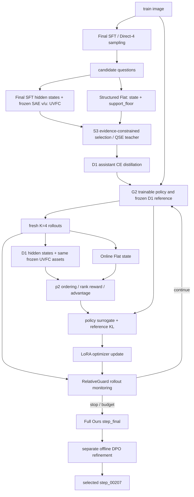

# 当前论文方法：真实代码地图

审计日期：2026-10-08。范围由用户指定的两个 checkpoint 决定；CURRENT 表示仍是这两个产物的依赖，不表示现在有训练任务。此次只读代码、配置、已有记录，并新增指定的四份文档；未训练、推理、调用评测 API、移动、删除或修改环境。

## 1. 一眼看懂最终运行哪些文件

**Full Ours = Final SFT → Direct-4 → UVFC + Flat → S3 → D1 单目标蒸馏 → G2 静态 UVFC 组相对优化 + 初始化相对停止保护。**

| 目标 | 实际入口 / 配置 | 结果 |
|---|---|---|
| Full Ours 最后训练阶段 | [train_online_uvfc_relative.py](../../scripts/vvqg/train_online_uvfc_relative.py) → [online_uvfc_relative_grpo.py](../../src/vvqg/training/online_uvfc_relative_grpo.py)::`run_online`；[qse_relativeguard.yaml](../../configs/phase5c/qse_relativeguard.yaml) | [step_final](../reproducibility/EXTERNAL_REFERENCE_INDEX.md#external-a33bc597bca7)，`global_step=256` |
| Full Ours 的 QSE 初始化 | [phase5c_distill.py](../../scripts/vvqg/phase5c_distill.py)，实际参数见 [D1 training_summary](../reproducibility/EXTERNAL_REFERENCE_INDEX.md#external-a8ef5c32dfc8) | [D1 checkpoint-final](../reproducibility/EXTERNAL_REFERENCE_INDEX.md#external-1f19a5c5d814) |
| Full Ours + DPO，独立后处理 | [dpo_v1_formal_train.py](../../scripts/vvqg/dpo_v1_formal_train.py) → [dpo_pilot/trainer.py](../../src/vvqg/dpo_pilot/trainer.py)::`run_dpo`；[config_resolved.json](../reproducibility/EXTERNAL_REFERENCE_INDEX.md#external-f1774c9ae520) | [step_00207](../reproducibility/EXTERNAL_REFERENCE_INDEX.md#external-ee3cf10019f3)，不是 DPO `step_final` |
| 两个最终模型的独立推理 | [generate.py](../../scripts/vvqg/generate.py) → [generator.py](../../src/vvqg/generation/generator.py)::`VQGGenerator`，显式传上述 adapter | image + 固定指令 → question；不运行在线 UVFC、Flat、S3、RelativeGuard |

**复现边界：当前 G2 文件已加入连续 3 步退化才停止的条件；历史 step 256 产物来自单步越界停止行为。当前入口和配置定位正确，但直接重跑当前文件不能声称会复现同一个停止点。** 历史源码的精确快照尚未定位；详见 [技术说明](CURRENT_METHOD_TECHNICAL_SPEC.md) §5。

## 2. Full Ours 的文件与数据依赖

| 阶段 | 代码及真实调用 | 输入 → 输出 / 证据 |
|---|---|---|
| 初始 SFT 数据 | [prepare_sft_data.py](../../scripts/vvqg/prepare_sft_data.py)；[train_sft.py](../../src/vvqg/training/train_sft.py)::`load_records` | VQAv2 → `src/vvqg/data/sft/train.jsonl`，50,000 条 `{image, question}` |
| Final SFT | `train_sft.py::main/train` → [trainer_base.py](../../src/vvqg/training/trainer_base.py)::`load_model_and_processor`；[sft.yaml](../../configs/new_vqg/sft.yaml) | Qwen3-VL-8B-Instruct + LoRA → `outputs/checkpoints/qwen3vl8b_lora_r16_vqav2_50k/checkpoint-final`；[训练记录](../reproducibility/EXTERNAL_REFERENCE_INDEX.md#external-cde7903d242d)：50k、2 epochs、6250 steps |
| 冻结 UVFC 资产 | [phase26_vfc.py](../../scripts/vvqg/phase26_vfc.py)::`train_split/Activations.batch/train_sae/calibrate` | Final SFT 人类问题激活、真实/灰图校准、SFT greedy 频率 → `outputs/phase26/vfc/{sae.pt,weights.pt}`；[manifest](../reproducibility/EXTERNAL_REFERENCE_INDEX.md#external-27ea0c50d912) |
| 方法训练 manifest | [phase4b_prepare.py](../../scripts/vvqg/phase4b_prepare.py)::`main` | SFT train → [train_10000.jsonl](../reproducibility/EXTERNAL_REFERENCE_INDEX.md#external-489036b46646)：10,000 records / 9,184 unique images，816 条额外记录；G2 只消费图像字段 |
| Direct-4 | [phase5b_direct4_generate.py](../../scripts/vvqg/phase5b_direct4_generate.py)::`main` → [online_uvfc_grpo.py](../../src/vvqg/training/online_uvfc_grpo.py)::`build_frozen_model` → [inference.py](../../src/vvqg/generation/inference.py)::`generate_questions` | Final SFT 对 train 图像采样 K=4 → [teacher pool](../reproducibility/EXTERNAL_REFERENCE_INDEX.md#external-d974fde15806)，35,097 candidates / 9,184 images；[生成参数](../reproducibility/EXTERNAL_REFERENCE_INDEX.md#external-3a18303e7de2) |
| Teacher 评分 | [phase5b_score_candidates.py](../../scripts/vvqg/phase5b_score_candidates.py)::`main` → [uvfc.py](../../src/vvqg/rewards/visual_information/uvfc.py)::`score_uvfc` + [structured_flat.py](../../src/vvqg/rewards/support/structured_flat.py)::`StructuredFlatVerifier.verify_structured/support_summary` | candidates → [candidates_scored.jsonl](../reproducibility/EXTERNAL_REFERENCE_INDEX.md#external-8c5b38cb2db9)，含 UVFC、flat_state、support_floor；此处激活模型是 Final SFT |
| S3 与 D1 targets | [phase5c_build_targets.py](../../scripts/vvqg/phase5c_build_targets.py)::`main` → [phase5c_select.py](../../scripts/vvqg/phase5c_select.py)::`s3` → 空集合时 [phase5b_select.py](../../scripts/vvqg/phase5b_select.py)::`s1` | scored pool + 10k manifest → [targets_d1_single.jsonl](../reproducibility/EXTERNAL_REFERENCE_INDEX.md#external-6527ca824429)，两 epoch 使用同一个 best_question；τ=0.5 |
| D1 蒸馏 | [phase5c_distill.py](../../scripts/vvqg/phase5c_distill.py)::`main` → `train_sft.prepare_rows/ChatDataset/make_collator` → model CE | Final SFT 初始化，2 epochs、1250 steps、lr=2e-4、batch 2×accum 8 → D1；无独立 Phase5C D1 YAML，CLI 默认值与 summary 是依据 |
| G2 初始化 | `train_online_uvfc_relative.py::main/resolve` → `online_uvfc_relative_grpo.run_online` → [fixed_group_relative.py](../../src/vvqg/training/fixed_group_relative.py)::`build_trainable_model` + `build_frozen_model` | trainable policy = D1；KL reference = 冻结 D1；guard 原 SFT 基准另外加载 Final SFT |
| G2 奖励和优势 | `run_online` L348–395 → `score_uvfc(reference, …)` + [online_flat.py](../../src/vvqg/rewards/support/online_flat.py)::`OnlineFlatVerifier.verify` → `canonicalize_group(..., "p2")` | 新采样问题 → violation-first / UVFC 排序 → tie-mean rank reward → 标准化 advantage；G2 无 S3/support_floor 调用 |
| 最终 loss | `online_uvfc_relative_grpo.py::_group_terms` L152–175；`fixed_group_relative.py::clipped_surrogate`；[policy_logprobs.py](../../src/vvqg/training/policy_logprobs.py)::`encode_group/gather_token_logprobs` | completion token logprobs + advantage → clipped surrogate + 0.02 × reference KL |
| Guard / 保存 | `run_online` L265–284、L511–524；`_degenerate/save_checkpoint` | 初始化校准阈值 + 当前 rollout 统计 → stop_reason；LoRA + processor + optimizer/RNG/state + CHECKPOINT.json |

调用关系是主判断依据。`online_uvfc_grpo.py` 的 **model-loading helper** 仍被 Direct-4/teacher 使用，尽管其旧训练入口已被 G2 替代。`fixed_group_relative.py` 的排名和 loss helper 也仍是 CURRENT，不能整文件按 Phase3A 归为废弃。

## 3. 数据流：QSE 在 RL 之前，Guard 控制训练循环

不应把 `UVFC → QSE → RelativeGuard → loss` 画成一个可微线性网络。QSE 先产生 D1 初始化；G2 以 UVFC/Flat 排名得到 advantage；Guard 在更新后决定继续或停止。

## 4. 推理与评估入口

- **独立推理**：`scripts/vvqg/generate.py --checkpoint <明确的最终adapter>`，内部 `GenerationConfig → VQGGenerator → PeftModel.from_pretrained → model.generate`。CLI 默认 checkpoint 仍指向 SFT，必须显式指定最终模型。
- **G2 训练结束时内置推理**：`online_uvfc_relative_grpo.run_online` L528 起直接复用 policy → `_generate → generate_questions`，产出 `greedy1000.jsonl` 和 `sampled4x1000.jsonl`。
- **既有 checkpoint sweep**：[phase5a_generate_checkpoints.py](../../scripts/vvqg/phase5a_generate_checkpoints.py)，尽管名字为 phase5a，可指定 G2 run-dir/tags。
- **当前评估**：[evaluate.py](../../scripts/vvqg/evaluate.py)、[evaluate_visual_centric.py](../../scripts/vvqg/evaluate_visual_centric.py)、[evaluate_visual_support.py](../../scripts/vvqg/evaluate_visual_support.py)；训练用 Flat 与独立 GPT-4o 评估器必须区分。
- **已冻结的最终协议**：[FINAL_EVAL_FREEZE.json](../../reports/main/final_evaluation_20261008/FINAL_EVAL_FREEZE.json)、[GENERATION_ACCOUNTING.json](../../reports/main/final_evaluation_20261008/GENERATION_ACCOUNTING.json)：两个模型均 greedy、max_new_tokens=32、seed=42、batch=16。同目录 Markdown freeze 仍写 batch=8，JSON/实际 accounting 为 16，保留这一记录差异。

## 5. DPO 后处理的独立代码链

1. [ec_aligned_direct4_generate.py](../../scripts/vvqg/ec_aligned_direct4_generate.py)：Final SFT、训练指令对齐的 K4 采样；不是 Full Ours 原 QSE 使用的三行 DIRECT4 prompt。
2. [dpo_v1_formal_score.py](../../scripts/vvqg/dpo_v1_formal_score.py)：UVFC + Structured Flat；[dpo_v1_formal_pairs.py](../../scripts/vvqg/dpo_v1_formal_pairs.py)：35,139 个候选 → 原始 6633 对，路径 `outputs/offline_dpo_v1_formal_20261007T102440Z/data/pairs_train.jsonl`。
3. [overnight_matched_negative.py](../../scripts/vvqg/overnight_matched_negative.py)：同图、同 broad type 的 confirmed-violation/unsupported 负例匹配 → `reports/offline_dpo_matched_negative_20261008/TREATMENT_PAIRS.jsonl`，2733 对。
4. **最终 unified 合并专用持久化入口未找到**。实际 [DATA_MANIFEST.json](../reproducibility/EXTERNAL_REFERENCE_INDEX.md#external-3fba4b502431) 与全部 6633 行证明：chosen 不变，有 matched 则替换 rejected，否则保留原 rejected。`UNIFIED_PAIRS.jsonl` 与实际 trainer `pairs_train.jsonl` 的 image/id/chosen/rejected 全部一致。此步骤标记 `UNKNOWN_REQUIRES_REVIEW` 的源码溯源缺口，不虚构 builder。
5. [dpo_v1_formal_train.py](../../scripts/vvqg/dpo_v1_formal_train.py) → `src/vvqg/dpo_pilot/trainer.py::run_dpo`。实际 resolved config：batch=8、lr=5e-6、beta=0.1、constant LR、init/reference=Full Ours。
6. [PHASE1_REPORT.md](../reproducibility/EXTERNAL_REFERENCE_INDEX.md#external-ac5c8bbb5e74) 在 DEV256 比较现有轨迹；[FREEZE_RECORD.json](../../reports/main/offline_dpo_freeze_20261008/FREEZE_RECORD.json) 固定 step207，DEV744 做 secondary confirmation。最终 holdout 已在 [FINAL_HOLDOUT_REPORT.md](../../reports/main/final_evaluation_20261008/FINAL_HOLDOUT_REPORT.md) 报告，早期 freeze 的“仍 sealed”是当时状态。

注意：`dpo_v1_formal_union.py` 合并的是 **评估问题队列**，不是 unified 训练 pairs builder；`dpo_v1_formal_chain.sh` 的原始 train/devgen 分支使用旧 run / step_final，不能整体当成最终 DPO 启动器。

## 6. CURRENT / HISTORICAL / DIAGNOSTIC 判定与核验

完整文件表见 [SCRIPT_CLASSIFICATION.tsv](../archive/SCRIPT_CLASSIFICATION.tsv)，阶段历史见 [HISTORICAL_PHASE_MAP.md](../archive/HISTORICAL_PHASE_MAP.md)。

| 类别 | 文件数 |
|---|---:|
| CURRENT_MAIN_PIPELINE | 18（其中5个脚本仅属于DPO refinement） |
| CURRENT_EVAL | 23 |
| HISTORICAL_EXPERIMENT | 126 |
| DIAGNOSTIC_ONLY | 91 |
| UNKNOWN_REQUIRES_REVIEW | 130（其中93个是既有bytecode缓存） |
| 总计 | 388；295个非bytecode文件 |

- 扫描 `scripts/` 与 `configs/` 的每个现存文件，包括现存 archive 副本和 bytecode；每行记录类别、scope、实际内容证据、依赖和保留原因。
- DPO 的 CURRENT_MAIN_PIPELINE 行额外标记 `DPO_REFINEMENT`，不属于 Full Ours 核心 loss。
- GQA、独立 baseline 的训练脚本归 `UNKNOWN_REQUIRES_REVIEW / OUTSIDE_TARGET_LINEAGE`；不推断它们已废弃，更不据此清理。
- 已执行纯 CPU、无写入的内容回放：S3→D1 **10,000/10,000 一致**；DPO unified→trainer **6633/6633 一致**；G2 全日志 current guard 回放为 **0 个三步触发点、仅 step256 单步越界**；`max clip_fraction=0`。
- TSV路径集合与两个目录全部现存文件一一对应，无漏行或重复；三份Markdown中的75个本地链接目标均存在。
- 本审计证明现有产物的依赖与当前调用关系，未重跑 GPU、重算模型分数或重新哈希大权重。CHECKPOINT/freeze 中的 hashes 是已有记录，不冒充本次新计算。
- `CURRENT_STATUS.md` 的“无 DPO、GRPO 未开始”、部分入口 docstring 和旧输出路径已经过时；本图以两个指定 checkpoint 的配置、manifest、summary、数据一致性为准。
